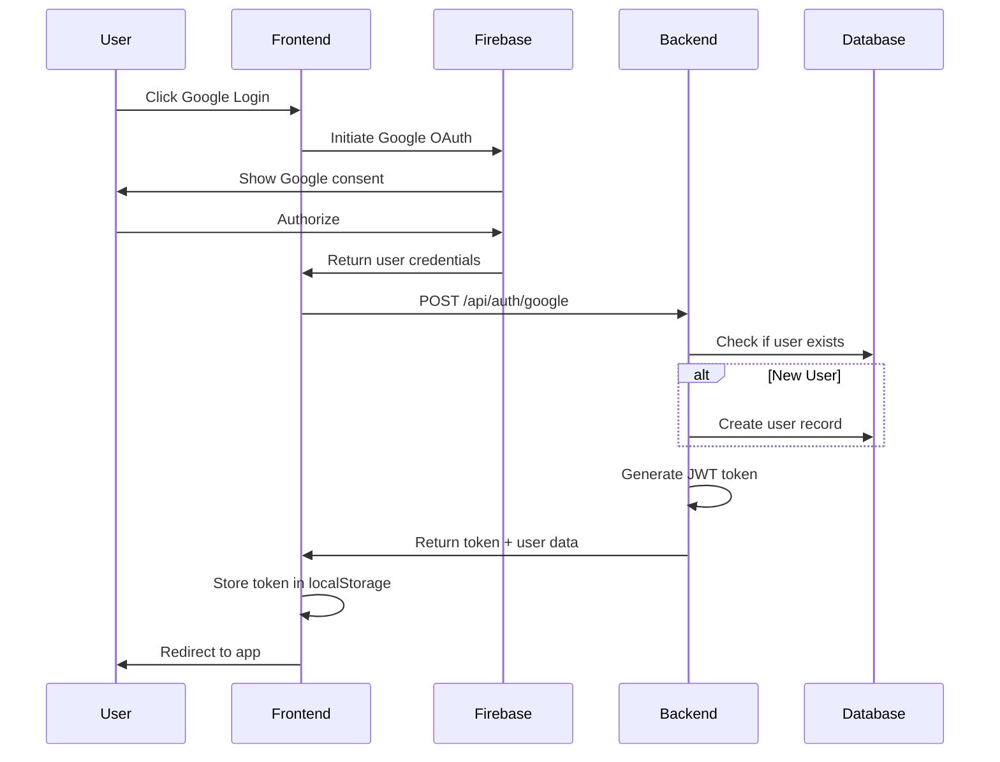

# Authentication & Authorization Specification

## Purpose
This document defines the authentication and authorization system for the Space platform, including JWT token management, Firebase integration, and access control.

## Authentication Overview

### Authentication Methods
- **Primary**: Firebase Google OAuth
- **Future**: Email/password authentication (prepared in database schema)
- **Token**: JWT (JSON Web Tokens) for session management

### Technology Stack
- **Frontend**: Firebase Auth (Google OAuth)
- **Backend**: JWT with bcryptjs
- **Storage**: localStorage for client-side token persistence
- **Database**: Users table with Firebase UID integration

## Authentication Flow

### 1. Google OAuth Login


### 2. JWT Token Management
- **Generation**: Server creates JWT with `userId` payload
- **Storage**: Client stores in localStorage
- **Validation**: Middleware validates on protected routes
- **Expiration**: Configurable expiration time

## API Endpoints

### Authentication Routes (`/api/auth`)

#### POST /api/auth/google
**Purpose**: Authenticate user with Google OAuth

**Request Body:**
```json
{
  "uid": "firebase-uid-string",
  "email": "user@example.com", 
  "displayName": "John Doe",
  "photoURL": "https://example.com/avatar.jpg"
}
```

**Response:**
```json
{
  "token": "jwt-token-string",
  "userData": {
    "id": 123,
    "email": "user@example.com",
    "username": "John Doe",
    "avatar_url": "https://example.com/avatar.jpg",
    "is_onboarded": false
  },
  "isNewUser": true
}
```

#### GET /api/auth/context
**Purpose**: Get current authenticated user context

**Headers:**
```
Authorization: Bearer <jwt-token>
```

**Response:**
```json
{
  "success": true,
  "error": "",
  "user": {
    "id": 123,
    "email": "user@example.com",
    "username": "john_doe",
    "bio": null,
    "avatar_url": "https://example.com/avatar.jpg",
    "avatar_seed": "seed-string",
    "avatar_options": "{\"style\":\"default\"}",
    "is_active": true,
    "created_at": "2024-01-15T10:30:00Z",
    "is_onboarded": false
  }
}
```

## JWT Token Format

### Token Payload
```json
{
  "userId": 123,
  "iat": 1640995200,
  "exp": 1641081600
}
```

### Token Claims
- **userId**: User's database ID (primary identifier)
- **iat**: "Issued At" timestamp (Unix epoch)
- **exp**: "Expiration" timestamp (Unix epoch)

## Frontend Authentication

### AuthContext Provider
```javascript
// Global authentication state management
const AuthContext = createContext(null);

// Available methods:
- login(userData, token)  // Store user session
- logout()                // Clear user session  
- fetchUser()             // Refresh user data
- loading                 // Auth state loading indicator
- user                    // Current user object
```

### Protected Routes
```javascript
// Route protection wrapper
<ProtectedRoute>
  <PrivateComponent />
</ProtectedRoute>
```

### Token Storage
- **Location**: localStorage
- **Key**: 'token'
- **Persistence**: Survives browser refresh
- **Cleanup**: Removed on logout/expiry

## Backend Authentication

### Middleware Implementation
```javascript
// JWT validation middleware
const checkAuth = (req, res, next) => {
  const authHeader = req.headers['authorization'];
  const token = authHeader?.split(' ')[1];
  
  if (!token) return res.status(401).json({ error: 'No token' });
  
  jwt.verify(token, process.env.JWT_SECRET, (err, user) => {
    if (err) return res.status(403).json({ error: 'Invalid token' });
    req.user = user;
    req.token = token;
    next();
  });
};
```

### User Data Structure
```javascript
// User fields returned to frontend
{
  id,                    // Primary key
  email,                 // Unique email
  username,              // Display username
  firebase_uid,          // Firebase authentication ID
  bio,                   // User biography
  avatar_url,            // Profile picture URL
  avatar_seed,           // Avatar generation seed
  avatar_options,        // Avatar generation options (JSON)
  is_active,             // Account status
  is_onboarded,          // Onboarding completion
  created_at,            // Account creation
  updated_at             // Last update
}
```

## Security Considerations

### JWT Security
- **Secret Key**: Environment variable `JWT_SECRET`
- **Algorithm**: HS256 (default)
- **Expiration**: Configurable (typically 24 hours)
- **Storage**: HTTP-only cookies recommended for production

### Firebase Integration
- **API Key**: Environment variable `VITE_FIREBASE_API_KEY`
- **Project ID**: Environment variable `VITE_FIREBASE_PROJECT_ID`
- **Auth Domain**: Environment variable `VITE_FIREBASE_AUTH_DOMAIN`

### Access Control
- **Route Protection**: Middleware validates JWT on protected endpoints
- **User Context**: Request populated with `req.user` after validation
- **Error Handling**: Standardized 401/403 responses

## Database Integration

### User Table Schema
```sql
-- Key authentication fields
firebase_uid    VARCHAR(255) UNIQUE NULLABLE  -- Firebase user ID
email           VARCHAR(255) UNIQUE NOT NULL -- Primary email
username        VARCHAR(50)  UNIQUE NULLABLE -- Display name
password        VARCHAR(255) NULLABLE        -- Future email/password

-- Profile fields
bio             TEXT NULLABLE                -- User biography
avatar_url      VARCHAR(500) NULLABLE        -- Profile picture
avatar_seed     VARCHAR(255) NULLABLE        -- Avatar generation
avatar_options  TEXT NULLABLE                -- Avatar settings (JSON)

-- Status fields
is_active       BOOLEAN DEFAULT TRUE        -- Account status
is_onboarded    BOOLEAN DEFAULT FALSE       -- Onboarding state
last_login      TIMESTAMP NULLABLE           -- Last activity
```

## Error Handling

### Authentication Errors
- **401 Unauthorized**: Missing or invalid token
- **403 Forbidden**: Expired or malformed token
- **404 Not Found**: User not found in database
- **500 Server Error**: Database or system failures

### Error Response Format
```json
{
  "success": false,
  "status": 401,
  "error_message": "Unauthorized - No token provided"
}
```

## Future Enhancements

### Planned Features
- **Email/Password Auth**: Traditional authentication method
- **Password Reset**: Email-based password recovery
- **Multi-Factor Auth**: Additional security layer
- **Session Management**: Active session tracking
- **Role-Based Access**: Admin/moderator permissions

### Security Improvements
- **HTTP-Only Cookies**: More secure token storage
- **Refresh Tokens**: Long-lived session refresh
- **Rate Limiting**: Login attempt protection
- **Audit Logging**: Authentication event tracking

## Dependencies

### Backend Dependencies
- **jsonwebtoken**: JWT token generation/validation
- **firebase-admin**: Firebase server SDK
- **bcryptjs**: Password hashing (future use)

### Frontend Dependencies  
- **firebase**: Firebase client SDK
- **react-context**: Global auth state management

## Testing Implementation

### Current Testing Setup
Unit testing is implemented using Jest with comprehensive test coverage for authentication functionality.

### Unit Tests
- JWT token generation/validation
- Middleware authentication logic
- User creation/retrieval functions
- Firebase integration mocking

### Integration Tests
- Complete OAuth flow
- Protected route access
- Token expiration handling
- Error response validation

### Security Tests
- Token manipulation attempts
- Unauthorized access prevention
- SQL injection protection
- XSS prevention in auth flows

This authentication system provides secure, scalable user management with Firebase integration and JWT-based session management for the Space platform.
