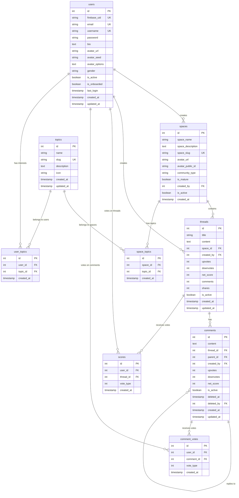

# Database Schema Specification

## Purpose
This document defines the complete database schema for the Space platform, including all tables, relationships, and constraints.

## Database Overview
- **Database**: PostgreSQL (Neon in production)
- **ORM**: Knex.js
- **Migration System**: Knex migrations
- **Naming Convention**: snake_case for tables and columns
- **Hosting**: Neon (managed PostgreSQL service)

## Entity Relationship Diagram



## Core Tables

### users
User accounts and authentication data.

```javascript
module.exports.up = async (knex) => {
  await knex.schema.createTable('users', (table) => {
    table.increments('id').primary();

    // Firebase integration
    table.string('firebase_uid').unique().nullable();

    // Basic user info
    table.string('email').unique().notNullable();
    table.string('username').unique().nullable();
    table.string('password').nullable(); // For future email/password auth

    // Profile
    table.text('bio').nullable();
    table.string('avatar_url').nullable();

    // Avatar generation fields
    table.string('avatar_seed').nullable();
    table.text('avatar_options').nullable(); // JSON string

    // Profile
    table.string('gender').nullable();

    // Status
    table.boolean('is_active').defaultTo(true);
    table.boolean('is_onboarded').defaultTo(false);
    table.timestamp('last_login').nullable();

    // Timestamps
    table.timestamp('created_at').defaultTo(knex.fn.now());
    table.timestamp('updated_at').defaultTo(knex.fn.now());

    // Indexes
    table.index('email');
    table.index('firebase_uid');
    table.index('username');
  });
};

module.exports.down = async (knex) => {
  await knex.schema.dropTable('users');
};
```

**Indexes:**
- Unique index on `email` (handled by `.unique()`)
- Unique index on `firebase_uid` (handled by `.unique()`)
- Unique index on `username` (handled by `.unique()`)
- Additional indexes on `email`, `firebase_uid`, `username` for performance

### spaces
Topic-based spaces where users gather and discuss.

```javascript
module.exports.up = async (knex) => {
  await knex.schema.createTable('spaces', (table) => {
    table.increments('id').primary();
    table.string('space_name').notNullable();
    table.text('space_description');
    table.string('space_slug').unique().notNullable();
    table.string('avatar_url');
    table.string('avatar_public_id');
    table.enu('community_type', ['public', 'restricted', 'private']).defaultTo('public');
    table.boolean('is_mature').defaultTo(false);
    table.integer('created_by').unsigned().notNullable();
    table.boolean('is_active').defaultTo(true);
    table.timestamp('created_at').defaultTo(knex.fn.now());

    // Indexes for performance
    table.index('space_slug');
    table.index('created_by');
    table.index('community_type');
  });
};

module.exports.down = async (knex) => {
  await knex.schema.dropTable('spaces');
};
```

**Indexes:**
- Unique index on `space_slug` (handled by `.unique()`)
- Index on `space_slug` (for lookup)
- Index on `created_by` (for user spaces)
- Index on `community_type` (for filtering)
- Foreign key index on `created_by` (should be added manually)


### threads
Discussion threads within spaces.

```javascript
module.exports.up = async (knex) => {
  await knex.schema.createTable('threads', (table) => {
    table.increments('id').primary();

    table.string('title').notNullable();
    table.text('content').notNullable();

    table.integer('space_id')
      .unsigned()
      .notNullable()
      .references('id')
      .inTable('spaces')
      .onDelete('CASCADE');

    table.integer('created_by').unsigned().notNullable();

    // Cached score fields
    table.integer('upvotes').defaultTo(0);
    table.integer('downvotes').defaultTo(0);
    table.integer('net_score').defaultTo(0);

    table.integer('comments').defaultTo(0);
    table.integer('shares').defaultTo(0);

    table.boolean('is_active').defaultTo(true);

    table.timestamp('created_at').defaultTo(knex.fn.now());
    table.timestamp('updated_at').defaultTo(knex.fn.now());

    // Indexes
    table.index('space_id');
    table.index('created_by');
    table.index('net_score'); // for sorting by top
  });
};

module.exports.down = async (knex) => {
  await knex.schema.dropTable('threads');
};
```

**Indexes:**
- Index on `space_id` (for space threads)
- Index on `created_by` (for user threads)
- Index on `net_score` (for sorting by top)
- Foreign key index on `space_id` (automatic)
- Foreign key index on `created_by` (should be added manually)

### comments
Replies to threads.

```javascript
module.exports.up = async (knex) => {
  await knex.schema.createTable('comments', (table) => {
    table.increments('id').primary();

    table.text('content').notNullable();

    table.integer('thread_id')
      .unsigned()
      .notNullable()
      .references('id')
      .inTable('threads')
      .onDelete('CASCADE');

    table.integer('parent_id')
      .unsigned()
      .nullable()
      .references('id')
      .inTable('comments')
      .onDelete('CASCADE');

    table.integer('created_by').unsigned().defaultTo(1); // Default user for now

    // Cached score fields
    table.integer('upvotes').defaultTo(0);
    table.integer('downvotes').defaultTo(0);
    table.integer('net_score').defaultTo(0);

    table.boolean('is_active').defaultTo(true);

    table.timestamp('created_at').defaultTo(knex.fn.now());
    table.timestamp('updated_at').defaultTo(knex.fn.now());

    // Indexes
    table.index('thread_id');
    table.index('parent_id');
    table.index('net_score');
  });
};

module.exports.down = async (knex) => {
  // Check if table exists before dropping
  const hasCommentsTable = await knex.schema.hasTable('comments');
  if (hasCommentsTable) {
    await knex.schema.dropTable('comments');
  }
};
```

**Indexes:**
- Index on `thread_id` (for thread comments)
- Index on `parent_id` (for nested comments)
- Index on `net_score` (for sorting by top)
- Foreign key index on `thread_id` (automatic)
- Foreign key index on `parent_id` (automatic)
- Index on `created_by` (should be added manually when users table exists)

## Voting Tables

### scores
Thread voting system (upvotes/downvotes).

```javascript
module.exports.up = async (knex) => {
  const hasScoresTable = await knex.schema.hasTable('scores');

  if (!hasScoresTable) {
    await knex.schema.createTable('scores', (table) => {
      table.increments('id').primary();

      table.integer('user_id').notNullable();

      table.integer('thread_id')
        .unsigned()
        .notNullable()
        .references('id')
        .inTable('threads')
        .onDelete('CASCADE');

      // 1 = upvote
      // -1 = downvote
      table.integer('vote_type').notNullable();

      table.timestamp('created_at').defaultTo(knex.fn.now());

      // Prevent double voting
      table.unique(['user_id', 'thread_id']);

      // Performance indexes
      table.index('thread_id');
      table.index('user_id');
    });
  }
};

module.exports.down = async (knex) => {
  await knex.schema.dropTable('scores');
};
```

**Indexes:**
- Unique composite index on `user_id, thread_id` (handled by `.unique()`)
- Index on `thread_id` (for thread votes)
- Index on `user_id` (for user votes)
- Foreign key index on `thread_id` (automatic)

### comment_votes
Comment voting system (upvotes/downvotes).

```javascript
exports.up = function (knex) {
  return knex.schema.createTable('comment_votes', function (table) {
    table.increments('id').primary();
    table.integer('user_id').unsigned().notNullable()
      .references('id').inTable('users').onDelete('CASCADE');
    table.integer('comment_id').unsigned().notNullable()
      .references('id').inTable('comments').onDelete('CASCADE');
    // 1 = upvote
    // -1 = downvote
    table.integer('vote_type').notNullable();
    table.timestamp('created_at').defaultTo(knex.fn.now());

    // Prevent double voting
    table.unique(['comment_id', 'user_id']);

    // Performance indexes
    table.index('comment_id');
    table.index('user_id');
  });
};

exports.down = function (knex) {
  return knex.schema.dropTable('comment_votes');
};
```

**Indexes:**
- Unique composite index on `comment_id, user_id` (handled by `.unique()`)
- Index on `comment_id` (for comment votes)
- Index on `user_id` (for user votes)
- Foreign key index on `comment_id` (automatic)

## Topic Tables

### topics
Available topics for spaces and user interests.

```javascript
module.exports.up = function(knex) {
    return knex.schema.createTable('topics', (table) => {
        table.increments('id').primary();       // Auto-incrementing ID
        table.string('name').notNullable();     // Topic name
        table.string('slug').notNullable().unique(); // URL-friendly identifier
        table.text('description');              // Optional description
        table.string('icon');                   // Optional icon (e.g., Remix Icon class)
        table.timestamps(true, true);           // created_at & updated_at
    });
}

module.exports.down = function(knex) {
    return knex.schema.dropTableIfExists('topics');
}
```

**Indexes:**
- Unique index on `slug` (handled by `.unique()`)
- Index on `name` (should be added manually for search)

### space_topics
Many-to-many relationship between spaces and topics.

```javascript
module.exports.up = async (knex) => {
  await knex.schema.createTable('space_topics', (table) => {
    table.increments('id').primary();
    table.integer('space_id').unsigned().notNullable();
    table.integer('topic_id').unsigned().notNullable();
    table.timestamp('created_at').defaultTo(knex.fn.now());
    
    // Foreign key constraints
    table.foreign('space_id').references('id').inTable('spaces').onDelete('CASCADE');
    table.foreign('topic_id').references('id').inTable('topics').onDelete('CASCADE');
    
    // Prevent duplicate space-topic relationships
    table.unique(['space_id', 'topic_id']);
  });
};

module.exports.down = async (knex) => {
  await knex.schema.dropTable('space_topics');
};
```

**Indexes:**
- Unique composite index on `space_id, topic_id` (handled by `.unique()`)
- Foreign key index on `space_id` (automatic)
- Foreign key index on `topic_id` (automatic)

### user_topics
Many-to-many relationship between users and topics (user interests).

```javascript
module.exports.up = function(knex) {
  return knex.schema.createTable('user_topics', function(table) {
    table.increments('id').primary();
    table.integer('user_id').unsigned().notNullable();
    table.integer('topic_id').unsigned().notNullable();
    table.timestamp('created_at').defaultTo(knex.fn.now());
    
    // Foreign key constraints
    table.foreign('user_id').references('id').inTable('users').onDelete('CASCADE');
    table.foreign('topic_id').references('id').inTable('topics').onDelete('CASCADE');
    
    // Prevent duplicate user-topic relationships
    table.unique(['user_id', 'topic_id']);
  });
};

module.exports.down = function(knex) {
  return knex.schema.dropTable('user_topics');
};
```

**Indexes:**
- Unique composite index on `user_id, topic_id` (handled by `.unique()`)
- Foreign key index on `user_id` (automatic)
- Foreign key index on `topic_id` (automatic)

## Relationships and Constraints

### Foreign Key Relationships
1. `spaces.creator_id` → `users.id` (SET NULL)
2. `space_members.space_id` → `spaces.id` (CASCADE)
3. `space_members.user_id` → `users.id` (CASCADE)
4. `threads.author_id` → `users.id` (SET NULL)
5. `threads.space_id` → `spaces.id` (CASCADE)
6. `comments.author_id` → `users.id` (SET NULL)
7. `comments.thread_id` → `threads.id` (CASCADE)
8. `comments.parent_comment_id` → `comments.id` (CASCADE)
9. `votes.user_id` → `users.id` (CASCADE)
10. `notifications.user_id` → `users.id` (CASCADE)
11. `user_sessions.user_id` → `users.id` (CASCADE)

### Unique Constraints
1. `users.username` must be unique
2. `users.email` must be unique
3. `space_members(space_id, user_id)` must be unique
4. `votes(user_id, target_type, target_id)` must be unique

## Data Integrity Rules

### Business Logic Constraints
1. A user cannot vote on their own content
2. A thread must belong to a space the author is a member of
3. Comments can only be nested up to 5 levels deep
4. Space names must be unique within a certain scope
5. User sessions expire after a configurable time period

### Cascade Rules
- Deleting a space deletes all its threads and memberships
- Deleting a thread deletes all its comments
- Deleting a user deletes their sessions and votes
- User content (threads, comments) is preserved when user is deleted (author_id set to NULL)

## Performance Considerations

### Indexing Strategy
- Primary keys have automatic indexes
- Foreign keys are indexed for join performance
- Frequently queried columns (created_at, counts) are indexed
- Composite indexes for complex queries

### Query Patterns
- Thread listings: ORDER BY created_at DESC, is_pinned DESC
- Comment threads: ORDER BY created_at ASC
- User feeds: JOIN with space_members for permissions
- Vote counting: Aggregate queries with proper indexing

## Migration Strategy

### Version Control
- All schema changes go through Knex migrations
- Migration files are numbered sequentially
- Rollback migrations are provided for each change
- Production migrations require review and testing

### Data Migration
- Schema changes include data migration when needed
- Backward compatibility is maintained during transitions
- Large dataset migrations are done in batches
- Performance impact is monitored during deployments

This schema provides a solid foundation for the Space platform's social features while maintaining data integrity and performance.
